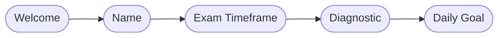
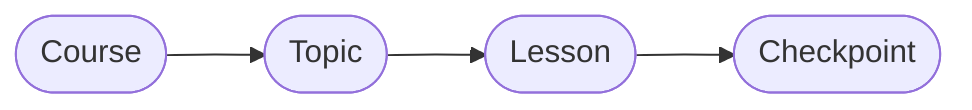
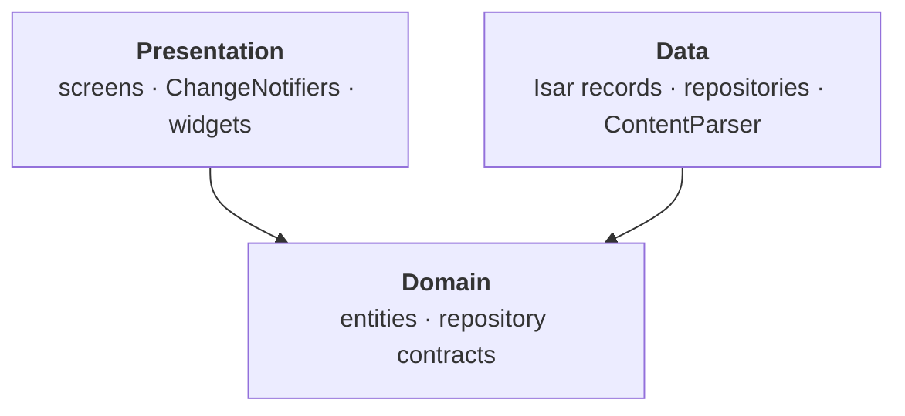

<div align="center">

<!-- Optional: add a logo at docs/assets/logo.png and uncomment the line below -->
<!--  -->

# CMAT Entrance-Prep LMS

**An offline-first, gamified learning companion for CMAT preparation, built with Flutter.**

<br/>


<br/>

[Features](#features) &nbsp;·&nbsp; [Learning Flow](#learning-flow) &nbsp;·&nbsp; [Architecture](#architecture) &nbsp;·&nbsp; [Tech Stack](#tech-stack) &nbsp;·&nbsp; [Getting Started](#getting-started)

</div>

---

## Overview

**CMAT Entrance-Prep LMS** turns exam preparation into a daily habit. Learners begin with a short diagnostic that uncovers their weakest **CMAT (Central Management Admission Test)** section, then follow a syllabus-driven path of lessons and checkpoints, earning XP, keeping streaks and unlocking mastery badges, with **Kit**, a friendly fox mascot, as their guide.

Everything runs on-device. Exam patterns, diagnostics and courses ship as validated JSON assets, and every answer is persisted locally with Isar. No connection required.

> Built as a 1-week Flutter skill assessment prototype.

---

## Features

<table>
<tr>
<td valign="top" width="50%">

### Adaptive Onboarding
A checkpointed flow that identifies the learner's weakest CMAT section and personalizes their starting path.

`Welcome → Name → Exam Timeframe → Diagnostic → Daily Goal`

</td>
<td valign="top" width="50%">

### Structured Learning Journey
Syllabus-driven progression with instant feedback, mistake review quizzes and replayable steps.

`Course → Topic → Lesson → Checkpoint`

</td>
</tr>
<tr>
<td valign="top" width="50%">

### Gamification & Progress
XP, levels, daily quests, 7-day activity streaks and section mastery badges, all guided by **Kit** 🦊, the interactive fox mascot.

</td>
<td valign="top" width="50%">

### 100% Offline-First
Exam patterns, diagnostics and section courses are bundled as validated JSON assets and persisted locally via Isar.

</td>
</tr>
</table>

---

## Learning Flow

**Onboarding** gets the learner from first launch to a personalized plan in five steps:



**The learning journey** then moves through the syllabus:



Every step gives instant feedback, mistakes feed a review quiz, and any step can be replayed.

---

## Architecture

The app follows a **feature-first, 3-layer** structure with strict dependency rules. Features stay decoupled through an interface-driven `LearningNavigator`, so no feature needs to know about another's screens.



| Layer | Responsibility |
| :-- | :-- |
| **Domain** | Core entities and repository contracts |
| **Data** | Isar persistence, repository implementations and JSON content loading |
| **Presentation** | Screens and screen-scoped state |

```text
lib/
└── features/
    └── <feature>/
        ├── domain/          # entities, repository contracts
        ├── data/            # Isar records, repositories, content parsing
        └── presentation/    # screens, ChangeNotifiers, widgets
```

### Key design decisions

- **State management & DI:** `provider`, with `ChangeNotifier` for screen-scoped state and `Provider.value` for app-wide repository singletons.
- **Single source of truth:** `Isar` stores progress in **append-only** tables (`LessonAttemptRecord`, `AnswerRecord`, `CheckpointResultRecord`). XP, levels, daily quests, streaks and badges are calculated from this history rather than stored as mutable counters.
- **Content engine:** a strongly-typed JSON parser (`ContentParser`) reports errors at field level, backed by automated schema and content validation tests, so malformed course content is caught before it reaches a learner.

---

## Tech Stack

| | |
| :-- | :-- |
| **Framework** | Flutter & Dart |
| **State & DI** | `provider` |
| **Local database** | `Isar` |
| **Content** | Bundled, validated JSON assets |
| **Architecture** | Feature-first, 3-layer (`domain` · `data` · `presentation`) |
| **Quality** | Automated schema and content validation tests |

---

## Getting Started

### Prerequisites

- [Flutter SDK](https://docs.flutter.dev/get-started/install) (stable channel)
- An Android emulator, iOS simulator or physical device

### Installation

**1. Clone the repository**

```bash
git clone https://github.com/<your-username>/<repo-name>.git
cd <repo-name>
```

**2. Install dependencies**

```bash
flutter pub get
```

**3. Generate Isar schemas** *(skip if the generated files are already committed)*

```bash
dart run build_runner build --delete-conflicting-outputs
```

**4. Run the app**

```bash
flutter run
```

The app is fully offline, so there is no backend or API key to configure.

### Running the tests

```bash
flutter test
```

This includes the schema and content validation tests that guard the bundled JSON courses.

---

<div align="center">

Built with Flutter by **Kishan**

<sub>A prototype created for a 1-week Flutter skill assessment.</sub>

</div>
